# Architecture

Pegg is a provider-agnostic AI coding agent written in Go. A single **engine** — the
agent runtime, session store, tool registry, and provider layer — is shared by every
surface: the [CLI](usage/cli.md), [TUI](usage/tui.md), [HTTP API](usage/http.md),
[ACP server](usage/acp.md), [Go SDK](../sdk/index.md), [Desktop](usage/desktop.md),
[VS Code](usage/vscode.md), and [IntelliJ](usage/intellij.md) clients.

This page explains how the pieces fit together. Every diagram is self-contained and
can be lifted straight into a slide deck.

## System map

The full technical picture in one diagram: surfaces drive the agent runtime, every LLM
and tool call passes through the middleware chain, tools are sandboxed by the VFS and
gated by permissions, and the event bus wires the runtime to memory, storage, and
integrations.

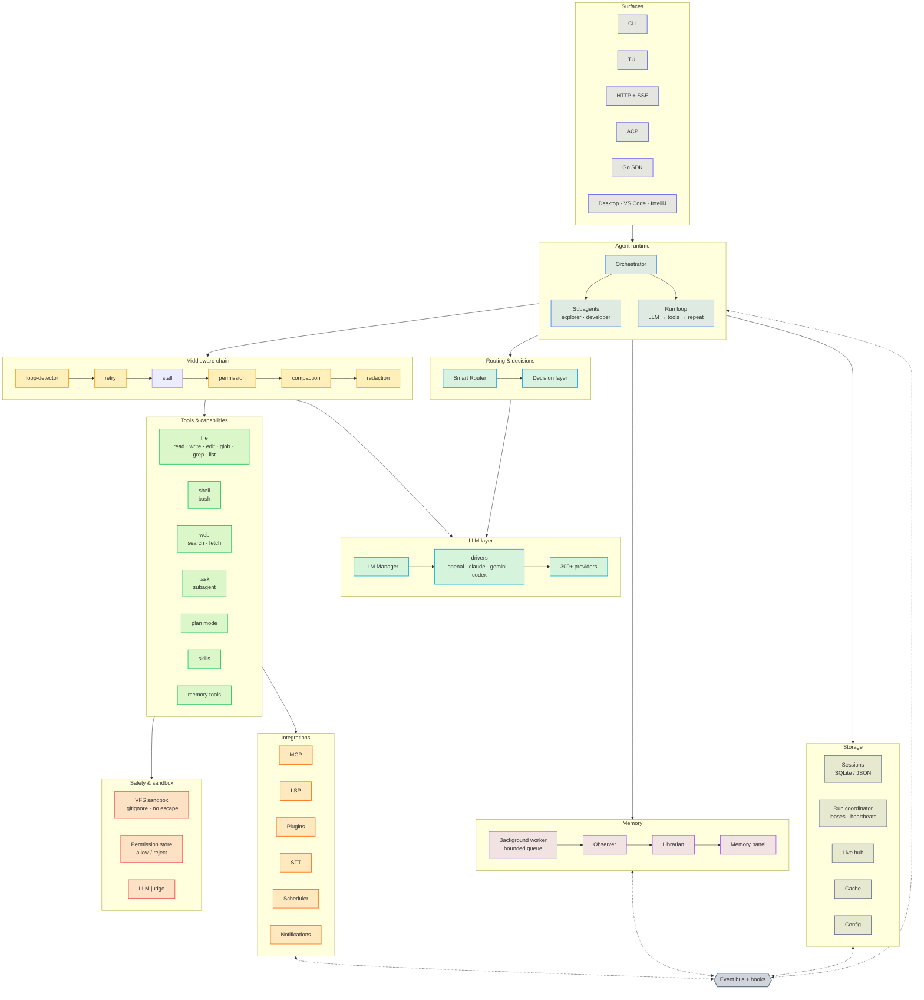

## Design principles

- **Provider-agnostic core.** The agent talks to an `llm.Provider` interface, never to a
  vendor SDK. Drivers (OpenAI, Claude, Gemini, Codex) and a catalog of 300+ providers
  plug in behind it. See [Providers & Models](providers-and-models.md).
- **Event-driven.** Components communicate over an in-process event bus and a generic
  filter-hook system, so the TUI, memory, recorder, and live hub observe runs without
  the agent knowing they exist.
- **Middleware pipeline.** Cross-cutting concerns — loop detection, retries,
  permissions, compaction, redaction — are composable middleware around the LLM and
  tool calls, not hard-coded branches.
- **Sandboxed by default.** All file access goes through a virtual filesystem that
  respects `.gitignore`/`.peggignore` and blocks directory escape.
- **One engine, many surfaces.** Frontends are thin; they drive the same runtime and
  render the same event stream.

## Layered architecture

The system is organized in five layers. Surfaces drive the runtime; the runtime uses
capabilities, providers, and storage.

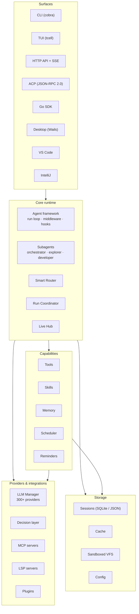

## The agent run loop

A run is a loop of *LLM call → tool calls → feed results back*, repeated until the
model stops asking for tools or the iteration budget is exhausted. Middleware wraps
every step.

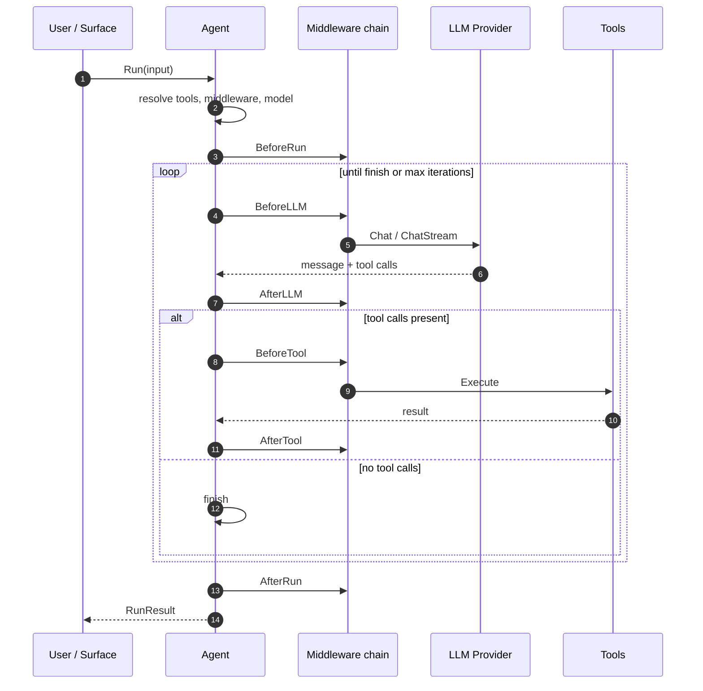

Key behaviours in the loop:

| Concern | Handling |
|---|---|
| Streaming | `ChatStream` emits tokens, reasoning, tool calls, and a final `done` event |
| Parallel tools | Up to 8 tool calls execute concurrently per iteration |
| Empty responses | Retried up to 3 times with a continuation nudge |
| Truncation | Recovered up to 3 times, escalating the output-token budget |
| Iterations | Default 150; the orchestrator runs unlimited |
| Cancellation | Context cancellation stops the loop and returns a partial result |

## Agent framework and subagents

The **orchestrator** is the top-level agent. It delegates to specialised subagents via
the `task` tool. Subagents inherit the parent's model and provider, run concurrently,
persist their own session, and can be resumed with follow-up messages.

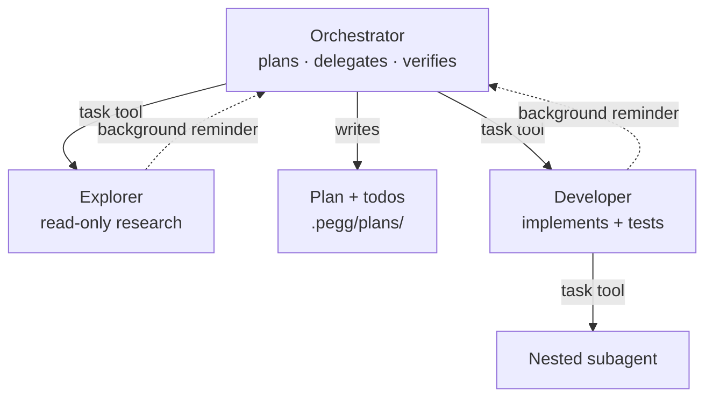

- **Foreground** subagents block the parent until they finish and return their output.
- **Background** subagents run detached; the parent gets a system reminder when they
  complete and is never blocked.
- Re-using a subagent **name** resumes it with its existing conversation history.

See [Subagents](features/subagents.md) for the full model.

## Middleware pipeline

Middleware implements a fixed set of hooks and can also wrap the LLM and tool
invocations (an onion model). The orchestrator's default chain is shown below;
`redaction` is registered globally and applied where configured.

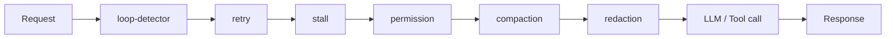

| Middleware | Responsibility |
|---|---|
| `loop-detector` | Detects repeated tool calls and text across turns, and aborts a stream when the same sentence or block repeats inside a single response |
| `retry` | Retries transient provider failures with backoff |
| `stall` | Detects silent provider requests and re-issues the same request without surfacing an error |
| `permission` | Gates sensitive tools (five modes, LLM judge, allow store) |
| `compaction` | Summarises or trims history near the context limit |
| `redaction` | Strips secrets (API keys, JWTs) before they reach the model |

The `Middleware` interface exposes seven hooks — `BeforeRun`, `AfterRun`, `BeforeLLM`,
`AfterLLM`, `BeforeTool`, `AfterTool`, `OnError` — plus optional `InvokeLLM`,
`InvokeLLMStream`, and `InvokeTool` wrappers. See [Permissions](features/permissions.md).

## Event bus and hooks

Components are decoupled by an in-process **event bus** (topic → handlers) and a
generic **filter-hook** system (value in → value out). The agent publishes; observers
subscribe.

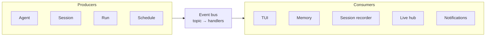

Representative topics:

| Group | Topics |
|---|---|
| Agent | `agent.started`, `agent.input`, `agent.message`, `agent.token`, `agent.tool.call`, `agent.tool.result`, `agent.usage`, `agent.finished`, `agent.error`, `agent.ask`, `agent.ask.answer` |
| Session | `session.created`, `session.updated`, `session.deleted`, `session.message.added`, `session.forked`, `session.reverted`, `session.compacted` |
| Run | `run.started`, `run.finished`, `run.ask.resolved` |
| App / LLM | `app.mounted`, `provider.added`, `provider.removed`, `llm.models.loaded` |
| Schedule | `schedule.created`, `schedule.started`, `schedule.finished`, `schedule.failed` |

Filter hooks let extensions rewrite values in flight — for example `OnModelResolve`
(the Smart Router), `OnMessageInput` (memory panel injection), and the VFS hooks
`OnBeforeRead` / `OnAfterWrite` (LSP diagnostics).

## LLM layer

The `llm.Manager` owns provider instances, model discovery, and pricing. A request
resolves to a `Provider` implementation, which is one of a handful of wire drivers
backed by a large provider catalog.

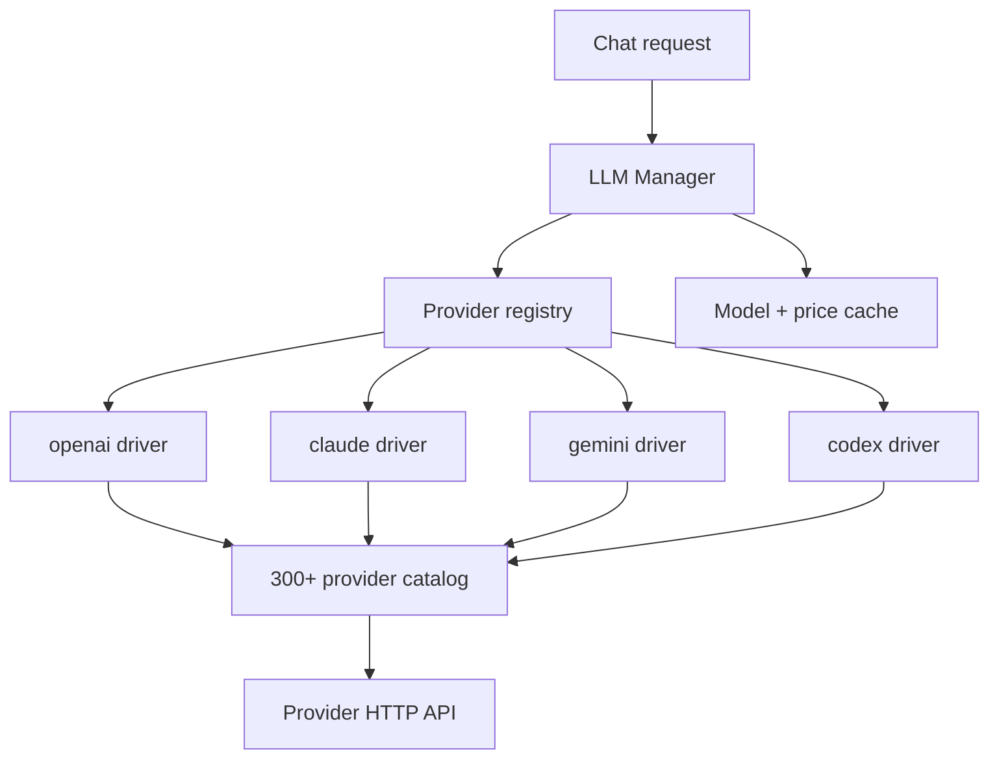

- Models are discovered from the provider API, cached, and enriched with context-window,
  pricing, and capability metadata.
- Credentials are read from provider config or local CLI credential stores.
- The manager exposes `Select` (exact or preferred) and `Provider` lookups used by the
  router, scheduler, and every surface.

## Smart Router and decision layer

When enabled, the **Smart Router** picks a model per task at run start by registering an
`OnModelResolve` hook. It scores task difficulty, builds a candidate list, and asks a
**decision model** (or an LLM fallback) to choose.

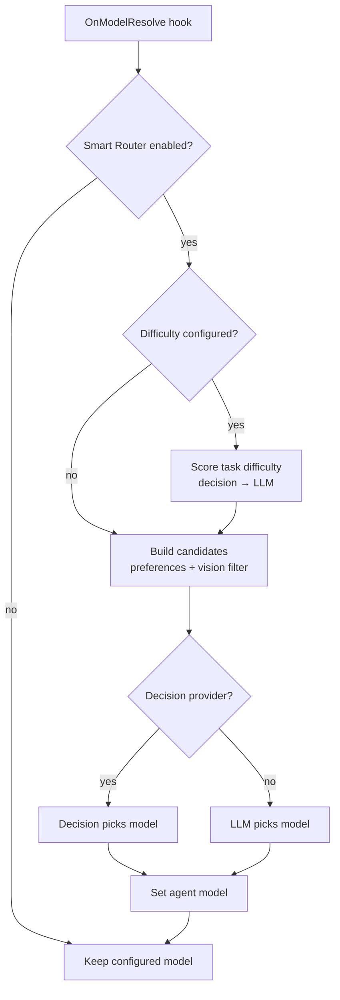

The **decision layer** (`internal/decision`) is a small interface — `noul`, `choice`,
and `score` questions — with providers such as OpenRouter's JEV. It is reused by the
router, the permission judge, and memory relevance gating.

## Sessions and run coordination

Sessions are persisted in SQLite (or JSON) and can be forked, reverted, and compacted
into chains. Concurrent runs are serialised per session by the **Run Coordinator**,
which hands out leases, heartbeats them, and reaps stale runs.

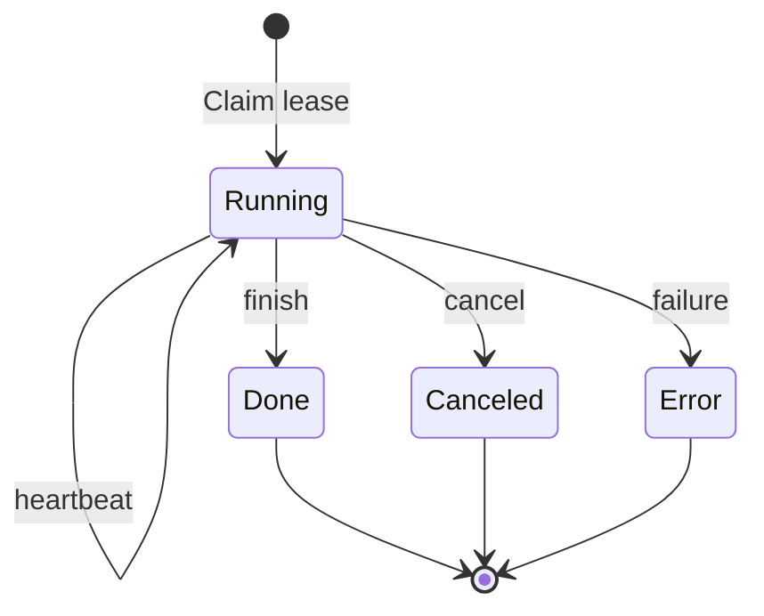

- The **Live Hub** polls run events and fans them out to subscribers (SSE, ACP, connect),
  so a run started in one process can be watched from another.
- The **Session Recorder** subscribes to agent events and persists messages as they
  stream.
- Compaction creates a child session linked to its parent, preserving the full history.

See [Sessions](features/sessions.md).

## Tools, skills, and plan mode

Tools are registered in a global registry and exposed to the model as function
definitions. Skills are markdown playbooks loaded on demand. Plan mode gates the
plan tools so the agent can research before acting.

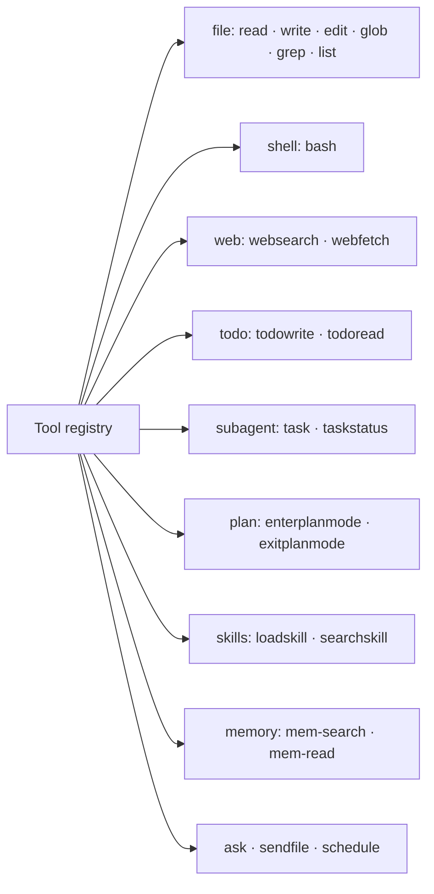

| Group | Tools |
|---|---|
| Files | `read`, `write`, `edit`, `glob`, `grep`, `list` |
| Shell | `bash` |
| Web | `websearch`, `webfetch` |
| Planning | `enterplanmode`, `exitplanmode`, `todowrite`, `todoread` |
| Delegation | `task`, `taskstatus` |
| Skills | `loadskill`, `searchskill` |
| Memory | `mem-search`, `mem-read` |
| Interaction | `askuserquestion`, `sendfile` |
| Automation | `schedule` |

See [Tools](configurations/tools.md) and [Skills](configurations/skills.md).

## Integrations

Beyond the LLM, the agent talks to several external systems. Each is optional and
degrades gracefully when unavailable.

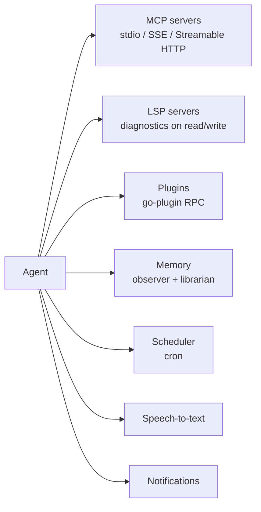

| Integration | Transport / mechanism | Docs |
|---|---|---|
| MCP | stdio, legacy SSE, or Streamable HTTP; tools registered into the registry | [MCP](configurations/mcp.md) |
| LSP | stdio; diagnostics appended to file reads/writes | [LSP](configurations/lsp.md) |
| Plugins | HashiCorp go-plugin over net/rpc | [Plugins](configurations/plugins.md) |
| Memory | markdown files + background LLM passes | [Memory](features/memory.md) |
| Scheduler | cron, each run saved as its own session | [Scheduling](features/scheduling.md) |
| STT | provider drivers (OpenAI, AssemblyAI, …) | [Voice input](features/voice.md) |

## Surfaces over one engine

Every frontend drives the same engine. The editor and desktop clients speak **ACP**
(JSON-RPC 2.0) to a local Pegg process; the CLI, TUI, HTTP server, and SDK embed the
engine directly.

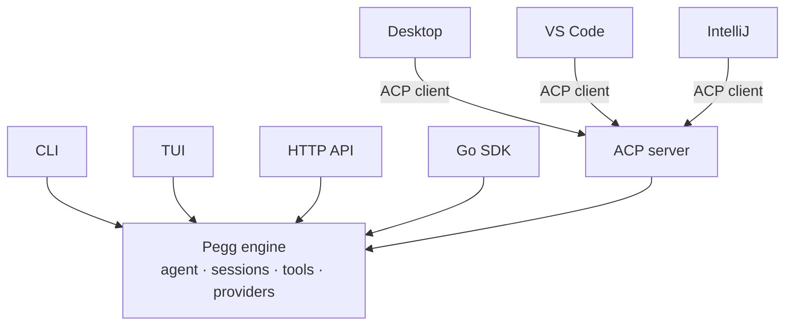

| Surface | Entry point | Transport |
|---|---|---|
| CLI | `pegg run` | in-process |
| TUI | `pegg` | in-process |
| HTTP API | `pegg serve` | REST + SSE |
| ACP | `pegg serve --acp` | stdio / HTTP+SSE / WebSocket |
| Go SDK | `pkg/sdk` | in-process |
| Desktop | Wails app | ACP over stdio |
| VS Code | extension | ACP over stdio |
| IntelliJ | plugin | ACP over stdio |

## Package map

```text
cmd/pegg/                 binary entry point
internal/
├── agent/                agent framework: run loop, middleware, hooks, tools, prompt
├── builtin/              built-in agents, middlewares, tools, reminders, skills
├── cli/                  cobra command tree and all subcommands
├── connect/              relay daemon (WebSocket) for the web client
├── core/                 event bus, hooks, config, bootstrap, cache, logger
├── decision/             decision-model interface and providers
├── live/                 run-event hub and fan-out
├── llm/                  provider manager, drivers, 300+ provider catalog
├── lsp/                  language-server manager and diagnostics
├── mcp/                  Model Context Protocol client
├── memory/               observer, librarian, store, search tools
├── plugin/               go-plugin host and shared interface
├── router/               Smart Router (per-task model selection)
├── run/                  run coordinator: leases, heartbeats, commands
├── schedule/             cron scheduler and run history
├── server/               HTTP API and SSE handlers
├── session/              session store, recorder, runs, compaction
├── skill/                skill engine and loader
├── skillhub/             skill hub install/search
├── stt/                  speech-to-text drivers and providers
├── tui/                  tcell terminal UI
├── vfs/                  sandboxed virtual filesystem
└── acp/                  Agent Client Protocol server
pkg/
├── sdk/                  embeddable Go SDK
├── desktop/              Wails desktop app + Go ACP client
├── chat-ui/              shared React chat renderer
├── vscode/               VS Code extension
└── intellij/             IntelliJ plugin
```

## Next steps

- [Overview](overview.md) — what Pegg is and what it can do.
- [Providers & Models](providers-and-models.md) — the provider layer in depth.
- [Subagents](features/subagents.md) — the delegation model.
- [Go SDK](../sdk/index.md) — embed the engine in your own program.
